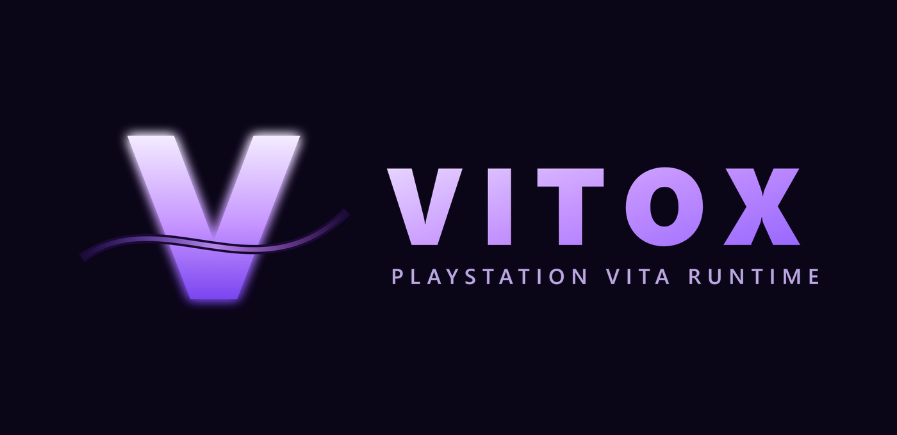
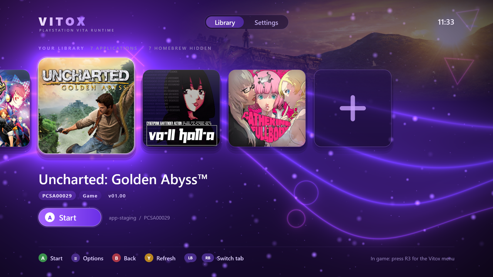
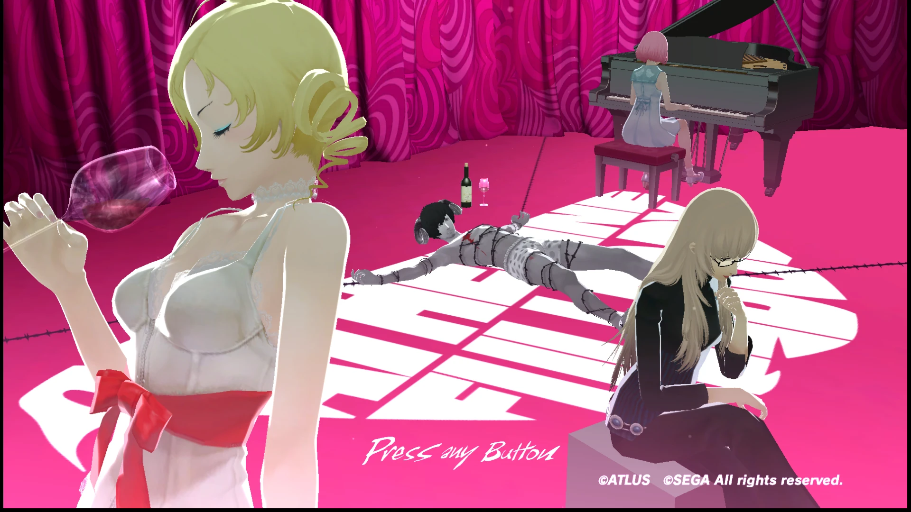
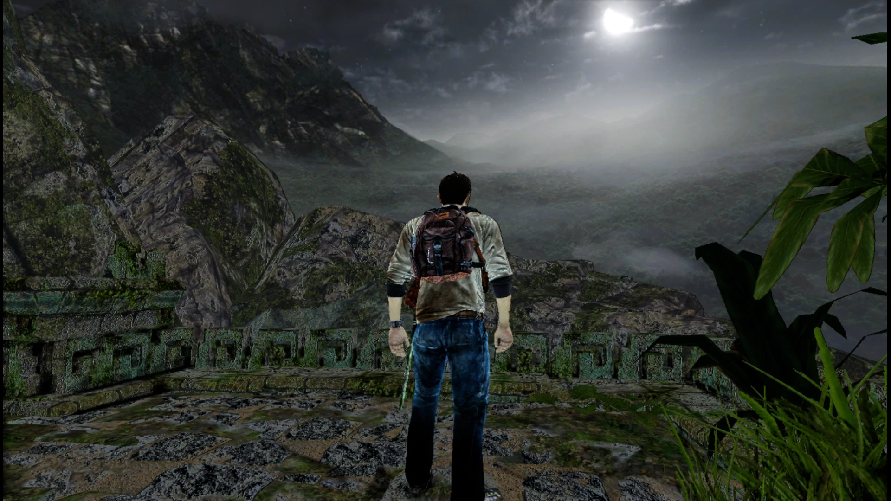
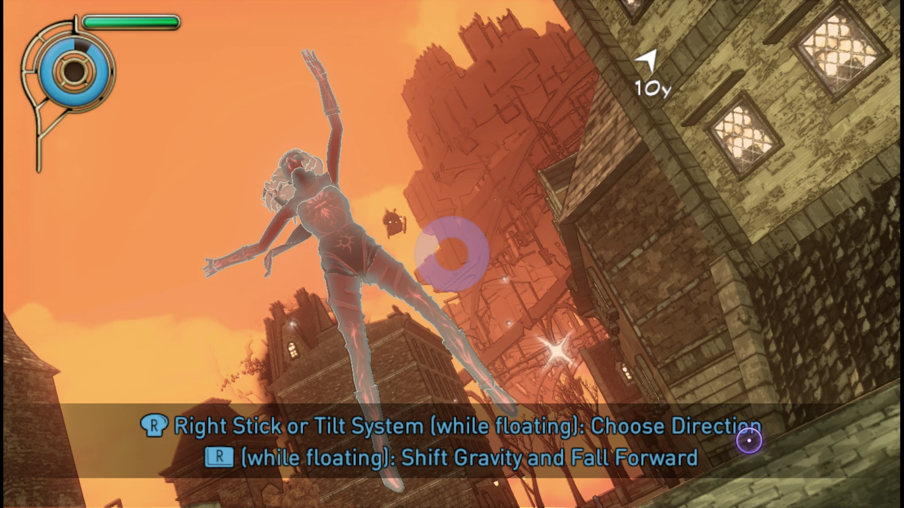
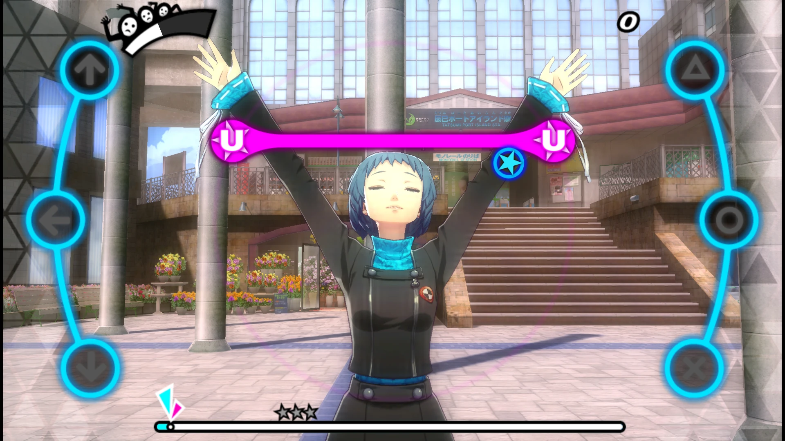

<p align="center"></p>

# Vitox

**Vitox** is a PlayStation Vita runtime for the **Xbox Series X|S** (Developer Mode). It packages the
[Vita3K](https://github.com/Vita3K/Vita3K) emulator core as a UWP app with a console-friendly library
launcher, so commercial Vita games and homebrew can be installed from a USB drive and played on an Xbox.

> Status: private, work in progress. No releases yet.

By **Nirally**, built with Claude.

---

## The launcher

<p align="center"></p>

The library shows every installed game with its artwork. Press **A** to start a game, **Menu** for per-game
options, **RB** for Settings, and the **+** tile to install games from a USB drive. In game, press **R3** for
the Vitox quick menu.

## Highlights

- **Vita3K core on Xbox UWP**: the upstream Vita3K core (CPU via Dynarmic JIT, HLE modules, GXM renderer) runs
  inside the Xbox app sandbox, with the console's W^X / JIT rules, codeGeneration capability and the 5 GB game
  memory limit.
- **Vulkan on Xbox through Mesa Dozen (Vulkan-on-D3D12)**: a WindowsStore build of Mesa 26.2.5 `dzn`, patched
  for the Xbox GPU (see `mesa/`). Fixes include 16-bit precision handling, aligned vertex input
  (vertex repacking in the Vita3K core), depth-surface handling and PSO compatibility.
- **Import gating**: every Vita system-library function (NID) a game calls is explicitly selected and
  reviewed (`core/core-probe/vitox_import_dispatch.cpp`); unselected calls stop the game cleanly instead of
  running unknown code. Network/ad-hoc features stay disabled (no real network traffic).
- **Library launcher** (D3D12 + Direct2D): game cards with artwork, per-game options, an in-game quick menu
  (press **R3**) and a "Return to Launcher" flow.
- **USB installer**: the "+" tile installs `.zip` / `.vpk` archives from a USB drive: games, updates,
  DLC and homebrew. NoNpDrm dumps are decrypted during installation (PFS, as upstream Vita3K does).
- **Settings**: controller remapping and stick dead zones, internal resolution upscaling (1x–4x),
  asynchronous shader compilation and shader pre-warming (with a loading screen), a performance statistics
  overlay (FPS / memory / CPU), library options (hide homebrew), SteamGridDB artwork (your own API key).
- **Per-game settings**: resolution, shader options and overlay can be set per title; uninstall with or
  without save data.
- **Saves, trophies, DLC**: save data and trophies are stored as on Vita3K; trophy unlocks show a banner
  (top-left, so it never covers the statistics overlay); DLC is found in `ux0:addcont/<TITLE_ID>`. DLC and the trophy banner are verified on console.
- **Audio** through an XAudio2 backend, **controllers** through Windows.Gaming.Input, touch emulated with the
  stick cursor.

## Tested games

| Game | Title ID | Region | Status | Notes |
|---|---|---|---|---|
| VA-11 HALL-A: Cyberpunk Bartender Action | PCSE00756 | US | ✅ Playable | Tutorial + chapters, saves, trophies, 30-minute stability run |
| Danganronpa Another Episode: Ultra Despair Girls | PCSE00692 | US | ✅ Playable | Picture, sound and movies OK; save/load OK |
| Persona 4: Dancing All Night | PCSE00764 | US | ✅ Playable | Models, rhythm sync and input timing OK; save/load OK; DLC works |
| Gravity Rush | PCSA00011 | US | ✅ Playable | Geometry, lighting and character colours fixed; title screen needs a touch (stick cursor) |
| Catherine: Full Body | PCSG01179 | JP | ✅ Playable | Gameplay, menus and text OK; save/load not yet tested |
| Persona 3: Dancing in Moonlight | PCSE01274 | US | ✅ Playable | Plays without issues |
| Uncharted: Golden Abyss | PCSA00029 | US | 🟡 In-game | Reaches gameplay; graphical glitches (being fixed) |
| Sly Cooper: Thieves in Time | PCSA00068 | US | 🔴 Does not install | The NoNpDrm decryption step fails during installation (under investigation) |

**Other games may work too — they simply have not been tested yet.** If you run another game with Vitox
(working or not), please let me know (open an issue) with the game, its title ID and what you saw, so I can add
it to the table.

## Firmware

On first start Vitox asks for three PS Vita firmware files. Download them from Sony's servers, copy them to a USB
drive (any name, any folder), connect it to the console and press **A** on the setup screen:

| Package | Download (official Sony server) |
|---|---|
| System software 3.74 | [PSVUPDAT.PUP](http://dus01.psv.update.playstation.net/update/psv/image/2022_0209/rel_f2c7b12fe85496ec88a0391b514d6e3b/PSVUPDAT.PUP) |
| Pre-installed package 3.74 | [PSP2UPDAT.PUP (preinst)](http://dus01.psp2.update.playstation.net/update/psp2/image/2022_0209/pre_efd1ef6c1cc2fe92e72e9e783e421237/PSP2UPDAT.PUP?dest=us) |
| Font package | [PSP2UPDAT.PUP (fonts)](http://dus01.psp2.update.playstation.net/update/psp2/image/2022_0209/sd_59dcf059d3328fb67be7e51f8aa33418/PSP2UPDAT.PUP?dest=us) |

Two of these files have the same name, so rename one (for example `PREINST.PUP`); Vitox recognises each file by its
contents. See also the [Vita3K Quickstart guide](https://vita3k.org/quickstart#firmware).

## Screenshots

Captured on an Xbox Series console running Vitox.

| | |
|---|---|
|  |  |
|  |  |

## How it works

```
Xbox (Dev Mode, UWP app "Vitox")
 ├─ app/      launcher UI, settings, USB installer, presenter, input, audio glue  (C++/WinRT, D3D12, D2D)
 ├─ core/     Vita3K core build for WindowsStore + Vitox launcher core           (CMake, static libs)
 │    ├─ core-build/CMakeLists.txt   builds Vita3K sources; small source substitutions are applied
 │    │                              at build time (the Vita3K checkout itself stays unmodified)
 │    ├─ core-probe/                 session launcher, import dispatch/gating, NoNpDrm, firmware staging
 │    ├─ compat/                     UWP replacements (BCrypt instead of OpenSSL, XAudio2, offline shims, ...)
 │    └─ sdl-shim/                   the few SDL functions Vita3K needs, without SDL
 ├─ mesa/     patch for Mesa 26.2.5 Dozen (Vulkan on D3D12) built for WindowsStore / Xbox
 └─ tools/xbox/  PC-side test harness (Windows Device Portal: deploy, launch, logs, screenshots, backups)
```

The Vita3K core is used unmodified from upstream commit
`7224a0fcc769fea781e4166e5f16a2456552f9f5`; every Xbox-specific change is either in this repository's own
sources or applied as a checked substitution by `core/core-build/CMakeLists.txt` (a build fails if the upstream
text it expects has changed).

## Building (overview)

Requirements: Windows 11, Visual Studio 2026 (C++ UWP workload, Windows SDK), CMake, Python 3, an Xbox in
Developer Mode.

1. Clone Vita3K at the commit above (with submodules) next to this repository.
2. Build Mesa 26.2.5 Dozen for WindowsStore with `mesa/vitox-uwp-mesa-26.2.5.patch` → `vulkan_dzn.dll`,
   and take `dxil.dll` from the Windows SDK redistributables; put both in `app/m6a/`.
3. Configure and build the core: `core/core-build` with CMake (x64, Release) → static libraries.
4. Build the app: `app/scripts/build.bat` (signs the package with your own test certificate; the certificate
   and its password are not part of this repository).
5. Deploy the `.msix` through Device Portal (or `tools/xbox/VitoxXbox.ps1 prepare -Deploy`).

Games, firmware files and licenses are **not** included. Use your own legally dumped games and the official
PS Vita firmware.

## Credits

- [Vita3K](https://github.com/Vita3K/Vita3K) and its contributors: the emulator core this project is built on.
- [Dynarmic](https://github.com/lioncash/dynarmic), [Mesa](https://www.mesa3d.org/) (Dozen),
  [psvpfstools](https://github.com/motoharu-gosuto/psvpfstools), miniz and the other libraries Vita3K uses.
- [SteamGridDB](https://www.steamgriddb.com/) for optional artwork.

Vitox is not affiliated with Sony, Microsoft or the Vita3K team. "PlayStation" and "PS Vita" are trademarks of
Sony Interactive Entertainment.

## License

Vita3K is licensed under the GNU GPL v2 (or later); Vitox builds on it and is distributed under the same terms
(GPL-2.0-or-later).
